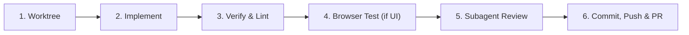

# AGENTS.md — Autonomous Agent Operating Protocol

Standard operating routines and expectations for AI coding agents working on `flat-sniffer`.

## 1. Golden Rules

1. **Always Work in Worktrees**: Never implement non-trivial features, bug fixes, or refactors directly on `main` or in the primary checkout. Always isolate changes in a dedicated worktree under `.worktrees/<branch-name>`.
2. **Lean & Pragmatic**: Prefer Python standard library primitives. Keep dependencies minimal (`httpx` only). Avoid speculative over-engineering or unnecessary layers of abstraction.
3. **Data Integrity is Sacred**:
   - `registry.json` and `sold_registry.json` schemas must remain consistent with the scraper diff engine and dashboard renderer.
   - All file writes to registries must remain atomic (write to temporary file, then rename).
4. **Never Hallucinate Business Data**: Listing counts, availability states, and pricing must be queried directly from `registry.json` or `sold_registry.json`. Do not guess figures.
5. **Self-Contained Dashboard**: The compiled `flat-dashboard.html` must remain a 100% self-contained single file with inlined CSS and JavaScript. Never link external CDNs or remote resources.

---

## 2. Standard Task Lifecycle

Every non-trivial agent task proceeds through these 6 stages without requiring manual steering from the user:



### Stage 1: Worktree Setup
Before modifying code, create a worktree branched from up-to-date `origin/main`:
```bash
git fetch origin main
git worktree add .worktrees/<feature-name> -b <feature-name> origin/main
cd .worktrees/<feature-name>
```
*(Or run `just wt-new <feature-name>` from repo root, then `cd .worktrees/<feature-name>`)*

### Stage 2: Implementation
- Keep changes minimal and focused on the assigned scope.
- Maintain existing comments and docstrings unless directly related to the modification.
- Avoid introducing inline `style="..."` attributes in HTML templates; use centralized CSS classes in `templates/styles.css`.

### Stage 3: Verification & Linting
Run the project quality checks:
```bash
just check   # runs ruff check, ruff format --check, ty check, and unittest suite
```
All checks must pass with zero errors and zero warnings before proceeding.

### Stage 4: Frontend & Browser Verification (Mandatory when touching UI)
Whenever editing `templates/` (`dashboard.html`, `styles.css`, `app.js`) or `render_dashboard.py`:
1. Recompile the dashboard:
   ```bash
   just dashboard   # or uv run render_dashboard.py
   ```
2. Verify interactive features in the browser using the `agent-browser` MCP tools:
   - Navigate to `file://<repo-path>/flat-dashboard.html`
   - Test user interactions: click status filters, category tabs, and table sorting.
   - Check the browser console to confirm zero unhandled JavaScript errors or broken event handlers.

### Stage 5: Subagent Code Review
Before creating a PR, invoke a subagent as a senior code reviewer:
- **TypeName**: `self`
- **Role**: `Code Reviewer`
- **Model**: `inherit`
- **Prompt**:
  > "You are an expert Senior Code Reviewer. Review the diff on branch `<branch-name>` vs `origin/main` (`git diff origin/main..HEAD`).
  > Check:
  > 1. Code simplicity and avoidance of over-engineering.
  > 2. Dashboard self-containment (zero external assets/CDNs; styles & scripts inlined).
  > 3. Data schema invariants in `registry.json` and `sold_registry.json`.
  > 4. Verification that `just check` passes cleanly.
  > 5. Any UI/interaction regressions in `templates/app.js` or `flat-dashboard.html`.
  > Output prioritized findings: [BLOCKER], [RECOMMENDED], [OPTIONAL], or LGTM."
- Apply all valid reviewer recommendations immediately.

### Stage 6: Autonomous Git Delivery
Do not stop to ask "Should I commit?". Autonomously complete the delivery:
1. Stage modified files and commit with a Conventional Commit message (`feat:`, `fix:`, `refactor:`, `chore:`, `perf:`).
2. Push branch: `git push -u origin <branch-name>`.
3. Create PR via GitHub CLI:
   ```bash
   gh pr create --title "<type>: <concise description>" --body "<summary of changes & verification>"
   ```
4. Once merged, return to the repository root and clean up the worktree:
   ```bash
   cd ../..
   git worktree remove .worktrees/<feature-name>
   ```

---

## 3. Quick Reference for Commands

| Command | Purpose |
| :--- | :--- |
| `just check` | Full test and lint suite (Ruff, ty, unittests) |
| `just dashboard` | Recompile `flat-dashboard.html` |
| `just wt-new <name>` | Create new isolated worktree from `origin/main` |
| `just wt-clean` | Prune metadata for deleted worktrees (`git worktree prune`) |
